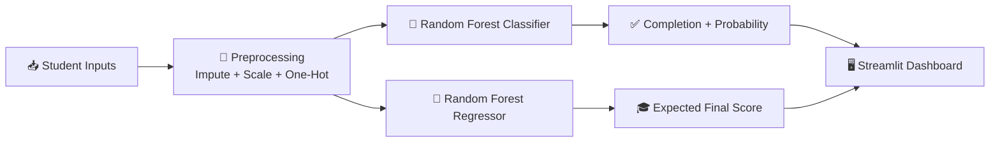

<div align="center">


<a href="https://smart-outcome-predictor-by-master.streamlit.app/">
  
</a>

<br/>

<a href="https://smart-outcome-predictor-by-master.streamlit.app/">
  
</a>


### 🚀 [Live Demo → smart-outcome-predictor-by-master.streamlit.app](https://smart-outcome-predictor-by-master.streamlit.app/)

</div>

---

## 📌 Overview

**Smart Outcome Predictor** is a machine-learning web app that analyses how an online learner behaves and predicts two things:

| Prediction | Type | Question answered |
|---|---|---|
| ✅ **Course Completion** | Classification | Will the student complete the course? (with probability) |
| 🎓 **Final Score** | Regression | What final score is the student likely to achieve? |

Educators and platforms can use it to spot at-risk students early and step in before they drop out.

---

## ✨ Features

- 🔮 **Instant predictions** - completion probability and expected final score in one click
- 🧾 **Simple input form** - student profile, course details, engagement and performance
- 📊 **Data Explorer** - preview data, statistics and interactive charts
- 🧠 **Model Insights** - see which features drive each prediction
- ⚡ **Fast and light** - Streamlit UI with cached models and data

---

## 🔄 How It Works



---

## 🧰 Tech Stack

| Layer | Tools |
|---|---|
| Language | Python |
| Data | Pandas, NumPy, OpenPyXL |
| Machine Learning | scikit-learn (Pipelines, Random Forest), Joblib |
| Web App | Streamlit |
| Deployment | Streamlit Community Cloud |

---

## 📂 Project Structure

```
Smart outcome Predictor/
│
├── app.py                 # Streamlit web application
├── requirements.txt       # Python dependencies
│
├── Data/
│   └── Smart_Outcome_Predictor_Dataset_5200.xlsx
│
├── Model/
│   ├── best_clf_pipeline.pkl   # Completion model
│   └── best_reg_pipeline.pkl   # Final-score model
│
└── Notebook/
    └── Smart Outcome Predictor.ipynb   # EDA + model training
```

---

## 🗃️ Dataset

5,200 learner records with 19 columns, including:

- **Profile:** age, region, device type, education background
- **Course:** level, category, start date, week of year
- **Engagement:** sessions, time spent, videos watched, quiz attempts, assignments submitted, forum posts
- **Performance:** average quiz score, attendance rate
- **Targets:** `completion_status` (classification) and `final_score` (regression)

---

## ⚙️ Run Locally

```bash
# 1. Clone the repository
git clone https://github.com/<your-username>/<your-repo>.git
cd <your-repo>

# 2. Install dependencies
pip install -r requirements.txt

# 3. Start the app
streamlit run app.py
```

> ⚠️ The saved models were trained with **scikit-learn 1.6.1**. Use the same version
> (`pip install scikit-learn==1.6.1`) to avoid loading or prediction errors.

---

## 🔭 Future Improvements

- Add SHAP-based explanations for individual predictions
- Batch prediction by uploading a CSV or Excel file
- Compare more models and tune hyperparameters
- Add authentication and a dashboard for instructors

---

## 👨‍💻 Owner

<div align="center">

### **Man Trivedi**

*Machine Learning • Data Science • Streamlit Apps*

[](https://smart-outcome-predictor-by-master.streamlit.app/)

⭐ If you like this project, give it a star!


</div>
