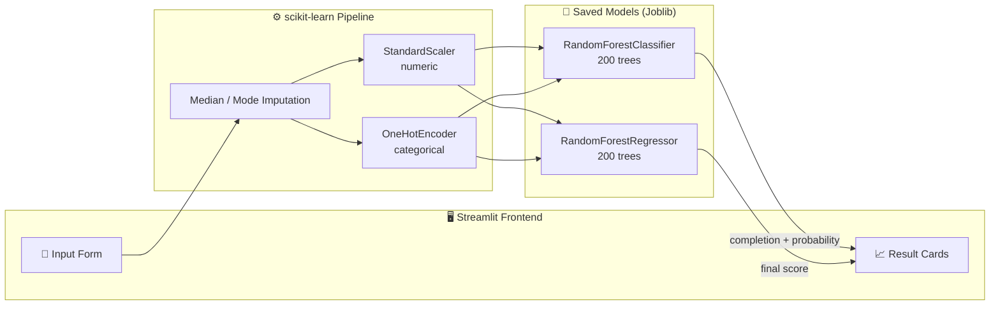
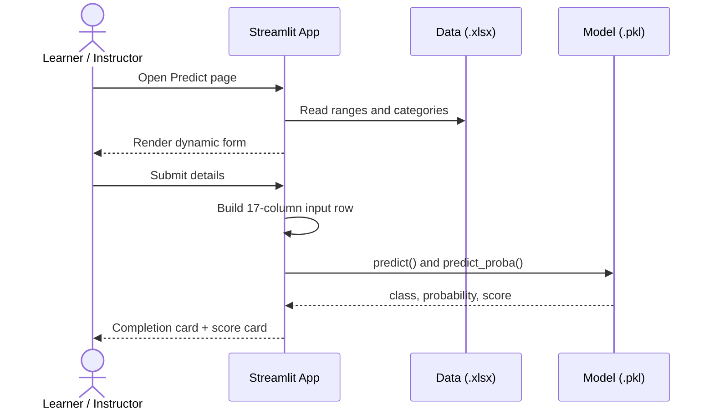
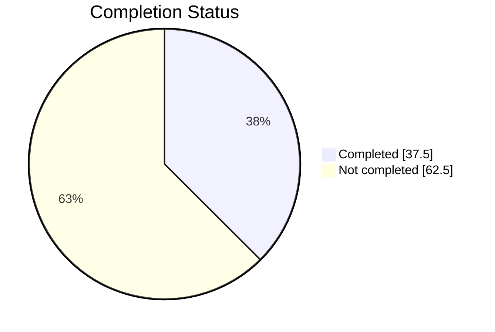
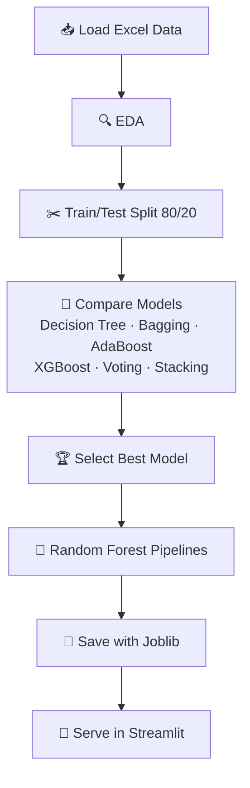

<div align="center">

<a href="https://smart-outcome-predictor-by-mantrivedi.streamlit.app/">
  
</a>

<a href="https://smart-outcome-predictor-by-mantrivedi.streamlit.app/">
  
</a>

<br/><br/>

[](https://smart-outcome-predictor-by-mantrivedi.streamlit.app/)
[](https://smart-outcome-predictor-by-mantrivedi.streamlit.app/)


</div>

---

## 📑 Table of Contents

- [Overview](#-overview)
- [Key Highlights](#-key-highlights)
- [Live App](#-live-app)
- [System Architecture](#-system-architecture)
- [Dataset](#-dataset)
- [Machine Learning Pipeline](#-machine-learning-pipeline)
- [What Drives the Predictions](#-what-drives-the-predictions)
- [Input Features](#-input-features)
- [Project Structure](#-project-structure)
- [Installation](#-installation)
- [Use the Models in Code](#-use-the-models-in-code)
- [Deployment](#-deployment)
- [Known Limitations](#-known-limitations)
- [Troubleshooting](#-troubleshooting)
- [Roadmap](#-roadmap)
- [Owner](#-owner)

---

## 📌 Overview

**Smart Outcome Predictor** analyses how an online learner behaves (sessions, time spent, quizzes,
attendance and more) and answers two questions in real time:

| | Prediction | Model type | Output |
|---|---|---|---|
| ✅ | **Course Completion** | Classification | Complete / Drop-out + probability |
| 🎓 | **Final Score** | Regression | Expected score out of 100 |

Instructors and learning platforms can use it to **identify at-risk students early** and intervene
before they drop out.

---

## 🌟 Key Highlights

<table>
<tr>
<td width="33%" align="center">

### 🔮 Dual Prediction
Completion probability and final score from a single form.

</td>
<td width="33%" align="center">

### 🧩 End-to-End Pipelines
Imputation, scaling and one-hot encoding are baked into each model, so there is no manual preprocessing.

</td>
<td width="33%" align="center">

### 📊 Built-in Analytics
Data Explorer and Model Insights pages inside the app.

</td>
</tr>
</table>

---

## 🚀 Live App

> ### 👉 **[smart-outcome-predictor-by-mantrivedi.streamlit.app](https://smart-outcome-predictor-by-mantrivedi.streamlit.app/)**

| Page | What you can do |
|---|---|
| 🏠 **Home** | See dataset-level metrics at a glance |
| 🔮 **Predict** | Enter a learner's details and get both predictions |
| 📊 **Data Explorer** | Browse data, statistics and group-wise charts |
| 🧠 **Model Insights** | See which features matter most for each model |
| ℹ️ **About** | Project and tech summary |

> 💡 Free Streamlit apps go to sleep after inactivity. If you see a "wake up" screen, click the button and wait a few seconds.

---

## 🏗️ System Architecture



### Request flow



---

## 🗃️ Dataset

**`Smart_Outcome_Predictor_Dataset_5200.xlsx`**: 5,200 learner records, 19 columns, course start dates across 2024.

| Fact | Value |
|---|---|
| Records | **5,200** |
| Learner age range | 16 – 45 |
| Overall completion rate | **37.5%** |
| Average final score | **74.8** (range 35.2 – 100) |
| Targets | `completion_status` (0 / 1) and `final_score` |



> The classes are imbalanced, so the classifier uses `class_weight="balanced"`.

---

## 🤖 Machine Learning Pipeline



| Component | Classification | Regression |
|---|---|---|
| Algorithm | Random Forest Classifier | Random Forest Regressor |
| Trees | 200 | 200 |
| Target | `completion_status` | `final_score` |
| Numeric prep | Median imputation + StandardScaler | Median imputation + StandardScaler |
| Categorical prep | Mode imputation + OneHotEncoder | Mode imputation + OneHotEncoder |
| Extra | `class_weight="balanced"` | n/a |

Full experiments live in [`Notebook/Smart Outcome Predictor.ipynb`](Notebook/Smart%20Outcome%20Predictor.ipynb).

---

## 🧠 What Drives the Predictions

Top feature importances extracted from the saved Random Forest models:

| Rank | Completion model | Importance | Final-score model | Importance |
|:---:|---|:---:|---|:---:|
| 1 | `avg_quiz_score` | 0.171 | `avg_quiz_score` | 0.324 |
| 2 | `attendance_rate` | 0.124 | `attendance_rate` | 0.133 |
| 3 | `time_spent_hours` | 0.088 | `time_spent_hours` | 0.127 |
| 4 | `sessions` | 0.077 | `videos_watched` | 0.065 |
| 5 | `videos_watched` | 0.070 | `sessions` | 0.052 |

**Takeaway:** quiz performance, attendance and study time are the strongest signals for both outcomes.

---

## 🧾 Input Features

<details>
<summary><b>Click to expand all 16 user inputs</b></summary>

<br/>

| Group | Feature | Type |
|---|---|---|
| 👤 Profile | `age` | Number |
| 👤 Profile | `country_region` | Categorical |
| 👤 Profile | `device_type` | Categorical |
| 👤 Profile | `education_background` | Categorical |
| 📚 Course | `course_level` | Categorical |
| 📚 Course | `course_category` | Categorical |
| 📚 Course | `course_start_date` (week of year is derived) | Date |
| 🖱️ Engagement | `sessions` | Number |
| 🖱️ Engagement | `time_spent_hours` | Number |
| 🖱️ Engagement | `videos_watched` | Number |
| 🖱️ Engagement | `quiz_attempts` | Number |
| 🖱️ Engagement | `assignments_submitted` | Number |
| 🖱️ Engagement | `forum_posts` | Number |
| 🎓 Performance | `avg_quiz_score` | Number (0–100) |
| 🎓 Performance | `attendance_rate` | Number (0–1) |

</details>

---

## 📂 Project Structure

```
Smart outcome Predictor/
│
├── app.py                       # Streamlit application (5 pages)
├── requirements.txt             # Pinned dependencies
├── README.md
│
├── Data/
│   └── Smart_Outcome_Predictor_Dataset_5200.xlsx
│
├── Model/
│   ├── best_clf_pipeline.pkl    # Completion model (Random Forest)
│   └── best_reg_pipeline.pkl    # Final-score model (Random Forest)
│
└── Notebook/
    └── Smart Outcome Predictor.ipynb   # EDA, training, model comparison
```

---

## ⚙️ Installation

```bash
# 1. Clone
git clone https://github.com/<your-username>/<your-repo>.git
cd <your-repo>

# 2. (Recommended) create a virtual environment
python -m venv venv
source venv/bin/activate        # Windows: venv\Scripts\activate

# 3. Install dependencies
pip install -r requirements.txt

# 4. Run
streamlit run app.py
```

Open **http://localhost:8501** in your browser.

> ⚠️ **Important:** the models were saved with **scikit-learn 1.6.1**. Keep that exact version
> (already pinned in `requirements.txt`) or loading and prediction will fail.

---

## 🧪 Use the Models in Code

You can use the pipelines without the web app:

```python
import joblib
import pandas as pd

clf = joblib.load("Model/best_clf_pipeline.pkl")
reg = joblib.load("Model/best_reg_pipeline.pkl")

student = pd.DataFrame([{
    "student_id": 700001,                      # identifier only
    "age": 28,
    "country_region": "Asia",
    "device_type": "Laptop",
    "education_background": "Graduate",
    "course_level": "Beginner",
    "course_category": "Data",
    "course_start_date": pd.Timestamp("2024-05-06"),
    "week_of_year": 19,
    "sessions": 12,
    "time_spent_hours": 20.5,
    "videos_watched": 15,
    "quiz_attempts": 5,
    "assignments_submitted": 5,
    "forum_posts": 3,
    "avg_quiz_score": 75.0,
    "attendance_rate": 0.82,
}])

print("Completion probability:", clf.predict_proba(student)[0][1])
print("Predicted final score :", reg.predict(student)[0])
```

---

## ☁️ Deployment

Deployed on **Streamlit Community Cloud**:

1. Push the project to a public GitHub repository.
2. Go to [share.streamlit.io](https://share.streamlit.io) and click **New app**.
3. Select the repo, branch `main` and main file `app.py`.
4. Click **Deploy**. Dependencies install from `requirements.txt`.

---

## ⚠️ Known Limitations

- **`student_id` is used as a model input.** It is just an identifier and shows up in the feature importances, so it adds noise. Retraining without it is on the roadmap.
- The dataset looks **synthetic / curated**, so real-world accuracy may differ.
- Predictions are **statistical estimates**, not guarantees. Use them to support decisions, not replace human judgement.
- Models depend on a specific scikit-learn version (see Installation).

---

## 🛠️ Troubleshooting

| Problem | Fix |
|---|---|
| `Prediction failed` / `SimpleImputer ... _fill_dtype` | Install `scikit-learn==1.6.1` |
| `Missing files` message in the app | Keep the `Data/` and `Model/` folders next to `app.py` with the exact file names |
| `ModuleNotFoundError: openpyxl` | `pip install openpyxl` (needed to read the `.xlsx`) |
| Cloud install fails | Remove built-in modules (like `json`) from `requirements.txt` |

---

## 🗺️ Roadmap

- [x] Dual prediction (completion + final score)
- [x] Interactive Streamlit dashboard
- [x] Feature-importance insights
- [ ] Retrain models without `student_id`
- [ ] SHAP explanations for each individual prediction
- [ ] Batch predictions from an uploaded CSV / Excel file
- [ ] Downloadable PDF report per student
- [ ] Model performance dashboard (confusion matrix, ROC, residuals)
- [ ] Authentication and instructor view

---

## 👨‍💻 Owner

<div align="center">


**Created and maintained by Man Trivedi**

[](https://smart-outcome-predictor-by-mantrivedi.streamlit.app/)
[](https://github.com/<your-username>)
[](https://linkedin.com/in/<your-profile>)

### ⭐ If you found this project useful, please give it a star!

<a href="https://smart-outcome-predictor-by-mantrivedi.streamlit.app/">
  
</a>

</div>
